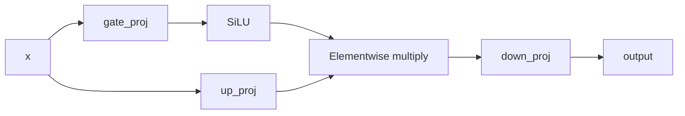

# SwiGLU MLP

This implements a **SwiGLU multilayer perceptron (MLP)**: it creates two learned versions of the input, uses one to gate the other, then projects the result back to the original size.

- `d_model`: number of features in the input and output.
- `d_ff`: number of features in the intermediate representation, usually larger than `d_model`.
- `nn.Module` and `super().__init__()`: make this a PyTorch module whose layers and parameters can be trained.

Each `nn.Linear(a, b)` learns a transformation from `a` features to `b` features, including a bias by default. [PyTorch Linear documentation](https://docs.pytorch.org/docs/2.14/generated/torch.nn.Linear.html)

The computation has two parallel branches:



Your `forward` method can be expanded into:

```python
def forward(self, x):
    gate = F.silu(self.gate_proj(x))  # (..., d_model) → (..., d_ff)
    values = self.up_proj(x)         # (..., d_model) → (..., d_ff)
    hidden = gate * values          # multiply corresponding features
    return self.down_proj(hidden)   # (..., d_ff) → (..., d_model)
```

**How the gate works:** `up_proj` produces intermediate features. The gate produces a multiplier for each feature, based on the same input. Multiplication lets the network suppress, amplify, or change the sign of those features.

`F.silu` applies the activation


$$

\operatorname{SiLU}(z)=z\,\sigma(z),
\qquad \sigma(z)=\frac{1}{1+e^{-z}}.

$$


SiLU is also called **Swish**, which gives SwiGLU its “Swi” prefix. Its output can be negative or greater than 1, so this gate is not a probability or a simple on/off switch. [PyTorch SiLU documentation](https://docs.pytorch.org/docs/2.14/generated/torch.nn.functional.silu.html)

For example:

```python
mlp = SwiGLUMLP(d_model=128, d_ff=384)
x = torch.randn(2, 10, 128)  # 2 sequences, 10 tokens, 128 features
y = mlp(x)                 # shape: (2, 10, 128)
```

Both branches temporarily produce `(2, 10, 384)`. The final layer restores `(2, 10, 128)`. Each token is processed independently using the same learned weights.
